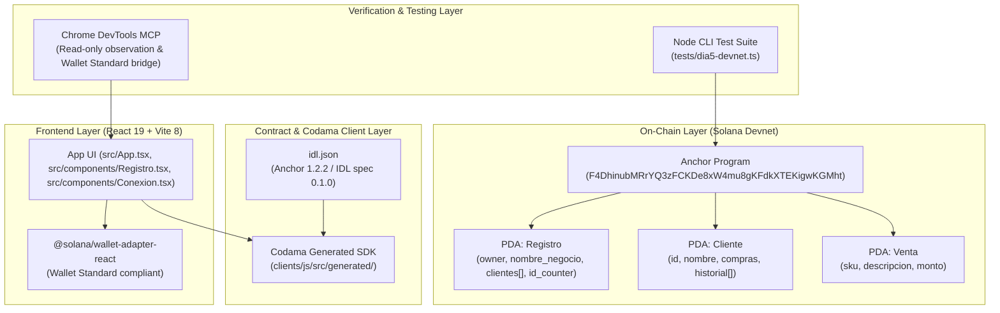

# System Architecture · Registro de Ventas App

This document outlines the architecture, account structures, Program Derived Address (PDA) derivations, and operational boundaries of the Registro de Ventas educational platform.

---

## 1. Multi-Tier System Overview

The system is structured into four distinct, loosely coupled layers:



---

## 2. Account Model & PDA Derivations

The on-chain program enforces hierarchical relationships between entities using deterministic PDAs:

```
[Autoridad / Owner Keypair]
        │
        ▼ (seeds: ["registro", nombre_negocio, owner])
┌────────────────────────────────────────────────────────┐
│ PDA: Registro                                          │
│ - owner: Pubkey                                        │
│ - nombre_negocio: String (max 30 bytes)                │
│ - clientes: Vec<Pubkey> (max 10)                       │
│ - id_counter: u16 (incremented upon each customer)     │
└────────────────────────────────────────────────────────┘
        │
        ▼ (seeds: ["cliente", registro_pda, id_cliente (u16 LE)])
┌────────────────────────────────────────────────────────┐
│ PDA: Cliente                                           │
│ - id_cliente: u16                                      │
│ - nombre: String (max 30 bytes)                        │
│ - compras: u16 (count of active sales)                 │
│ - historial: Vec<Pubkey> (max 10 active sales)         │
└────────────────────────────────────────────────────────┘
        │
        ▼ (seeds: ["venta", cliente_pda, sku])
┌────────────────────────────────────────────────────────┐
│ PDA: Venta                                             │
│ - sku: String (max 5 bytes)                            │
│ - descripcion: String (max 50 bytes)                   │
│ - monto: u32 (arbitrary units)                         │
└────────────────────────────────────────────────────────┘
```

### Derivation Seeds Summary
* **Registro PDA:** `[b"registro", nombre_negocio.as_bytes(), owner.key().as_ref()]`
* **Cliente PDA:** `[b"cliente", registro.key().as_ref(), &id_cliente.to_le_bytes()]`
* **Venta PDA:** `[b"venta", cliente.key().as_ref(), sku.as_bytes()]`

---

## 3. State Invariants & Operation Lifecycle

### Sales and Returns (`registrar_venta` / `hacer_devolucion`)
1. **Uniqueness:** A client can only have one active sale per SKU. Re-registering an existing SKU fails in preflight because the PDA account already exists.
2. **Return Lifecycle:** Calling `hacer_devolucion` removes the Venta PDA pubkey from `cliente.historial`, decrements `cliente.compras`, and completely closes the Venta account, refunding its rent to the authority.
3. **Re-registration:** Once returned and closed, the same SKU can be registered again under the same client.

### Customer Deletion (`eliminar_cliente`)
1. **Prerequisite:** Account must be registered in `registro.clientes`, and both `cliente.compras == 0` and `cliente.historial.is_empty()` must hold.
2. **Preflight Rejection:** If active sales exist, preflight simulation rejects the transaction with error `ClienteConVentas (0x1773 / 6003)`. No transaction lands on-chain, and accounts remain unchanged.
3. **Closure & Rent Refund:** When valid, the instruction closes the `Cliente` PDA, removes its address from `registro.clientes`, and transfers all rent lamports back to the authority (`owner`).
4. **Counter Preservation:** `registro.id_counter` is **not decremented**, preserving monotonic customer IDs.

---

## 4. Security & Isolation Boundaries

1. **Keypair Isolation:** Private keys never enter the web browser or repository. CLI tests load practice keys strictly from external paths (`~/.config/solana/`).
2. **Dual-Mode Frontend (`esReferencia`):** When `src/config/programa.json` has `esReferencia: true`, mutation operations are disabled in the UI to prevent uncoordinated writes to instructor reference deployments. Setting `esReferencia: false` requires importing the participant's verified IDL.
3. **Read vs Write Isolation:** Account state observation requires only the public authority address and business name; no connected wallet or signatures are needed to query on-chain state.

---

## 5. Architectural Decision References
* [ADR-0001: Decoupled CLI Signing and Chrome DevTools MCP Observation](./adr/0001-devnet-verification-browser-mcp.md)
* [ADR-0002: Strict Keypair Isolation and Ephemeral Signing Bridge](./adr/0002-external-keypair-isolation.md)
